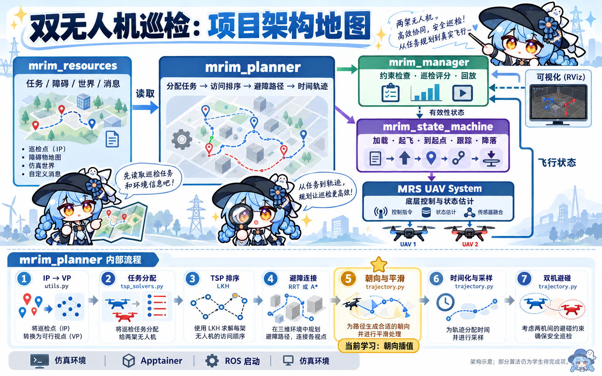

# 双无人机巡检项目：代码组织与架构导读

基于当前仓库源码整理，日期：2026-10-18。本文说明模块职责和实际连接关系，不代表全部学生算法已实现，也未执行安装或仿真。

代码现为 **v1.1.0（已学内容版）**，三项改动及验证范围见 [version1.1更新记录](VERSION_1.1.md)。本次架构图保留原有模块关系。

这个项目把“巡检哪些目标、按什么顺序、沿什么路线、什么时候到达”转换成两架无人机的轨迹，再检查、评分，并在仿真或飞行环境中执行。



图中角色仅作为讲解员。图示用于理解整体关系；精确的话题方向和职责以本文接口表与源码为准。

## 1. 目录地图

```text
ctu-mrs/
├── README.md                       安装、运行与任务说明
├── chinese.md                      此前的中文学习记录（内容为补丁文本）
├── install.sh                      安装入口
├── mrim_task/                      本项目的四个 ROS 包
│   ├── mrim_resources/             任务数据与消息定义
│   │   ├── problems/*.problem      起点、目标及任务要求
│   │   ├── obstacles/*.asc         障碍点云
│   │   ├── worlds/*.yaml           世界配置
│   │   └── msg/                    InspectionProblem / InspectionPoint
│   ├── mrim_planner/               规划算法，当前主要学习区域
│   │   ├── scripts/
│   │   │   ├── planner.py          总流程与 ROS 发布
│   │   │   ├── data_types.py       Point、Pose、Viewpoint 等
│   │   │   ├── utils.py            任务加载、IP→VP、消息转换等
│   │   │   ├── solvers/
│   │   │   │   ├── tsp_solvers.py  任务分配、代价矩阵、TSP 与路径连接
│   │   │   │   └── LKHInvoker.py   调用外部 LKH 求解器
│   │   │   ├── path_planners/
│   │   │   │   ├── sampling_based/rrt.py
│   │   │   │   └── grid_based/     astar.py、grid_3d.py
│   │   │   └── trajectory.py       朝向、平滑、时间化、采样与双机避碰
│   │   ├── config/                virtual.yaml、real_world.yaml
│   │   └── launch/planner.launch   启动规划器，同时包含 manager.launch
│   ├── mrim_manager/               检查、评分、监控与显示
│   │   ├── scripts/manager.py      管理入口，包含 Evaluator
│   │   ├── scripts/mrim_manager/
│   │   │   ├── task_monitor.py     飞行中的距离、动力学与里程监控
│   │   │   ├── visualizer.py       ROS / RViz 可视化
│   │   │   ├── python_plotter.py   动力学、距离等曲线
│   │   │   └── utils.py            评估端的数据结构与辅助计算
│   │   ├── config/                各运行模式默认约束、RViz 配置
│   │   └── launch/manager.launch
│   └── mrim_state_machine/         C++ 飞行执行协调
│       ├── src/mrim_state_machine.cpp
│       ├── config/                仿真、实机、世界与坐标变换配置
│       └── launch/                仿真、基站及 TF 连接启动文件
└── simulation/                     环境、编译、启动和会话编排
    ├── apptainer.sh                容器入口
    ├── 01_install.sh / 02_download.sh / 03_compile.sh
    ├── run_offline.sh              离线评估与回放
    ├── run_simulation.sh           启动仿真会话
    ├── kill_simulation.sh          结束仿真
    ├── recipes/                    容器构建配方
    ├── mount/                      容器环境初始化
    └── tmux_scripts/               多进程仿真会话编排
```

各 ROS 包中的 `package.xml` 声明依赖，`CMakeLists.txt` 配置构建、消息生成或安装，`launch/` 负责节点启动和连接，`config/` 保存参数。

## 2. 模块如何协作

可以用四个角色理解：resources 是资料库，planner 是路线规划员，manager 是检查与评分员，state_machine 是执行协调员。MRS UAV System 提供底层控制和状态估计。

```text
任务 / 障碍 / 配置
       │
       ▼
 mrim_planner ──任务与两条轨迹──► mrim_manager ──► 评分、检查、RViz
       │                              │
       │ 两条轨迹                     │ 有效性状态
       ▼                              ▼
 mrim_state_machine ◄──────────────────┘
       │ 加载轨迹、起飞、跟踪、降落等服务调用
       ▼
 MRS UAV System ──► 两架无人机 / 仿真器
       │
       └──飞行状态──► manager 与 state_machine
```

`mrim_resources` 主要提供文件与消息定义。实际读取任务的是规划器内的 `ProblemLoader`，不能把 resources 理解成主动向所有节点分发任务的服务器。

`planner.py` 初始化时加载任务并计算轨迹，随后发布并保持 ROS 节点运行。当前结构以预先生成整段轨迹为主；没有在主流程中持续接收飞行状态并在线重规划。

## 3. 规划器内部流水线

主入口：`MrimPlanner.planTrajectories()`，位于 `mrim_task/mrim_planner/scripts/planner.py`。

| 阶段 | 做什么 | 主要代码 |
| --- | --- | --- |
| 读取任务 | 获得起点、巡检目标、障碍和边界 | `utils.py`：`ProblemLoader` |
| IP 转 VP | 由目标及观察要求计算无人机观察位姿 | `utils.py`：`inspectionPointToViewPoint()` |
| 分配任务 | 固定归属目标直接分配，公共目标交给分配方法 | `planner.py`、`tsp_solvers.py`：`clusterViewpoints()` |
| 估计代价 | 为观察点对计算代价矩阵 | `tsp_solvers.py`：`plan_tour()` |
| 确定顺序 | 调用 LKH 求解访问顺序并返回起点 | `compute_tsp_sequence()`、`LKHInvoker.py` |
| 连接路径 | 根据顺序，用选定方法连接观察点 | `compute_path()`、`rrt.py`、`astar.py` |
| 生成轨迹 | 处理朝向、相应分支的平滑、时间安排及采样 | `trajectory.py` |
| 双机协调 | 按配置处理两条轨迹之间的碰撞 | `trajectory.py`：`resolveCollisions()` |
| 发布结果 | 转为 ROS 消息，发布两条轨迹 | `planner.py`、`utils.py` |

TSP 的代价估计方法与实际连接路径的方法可以不同。例如默认用欧氏距离估计访问代价，再用 RRT 求绕障路径。排序看起来很短，并不意味着实际飞行距离同样短。

任务分配、访问顺序、路径形状、时间安排是不同层次的决策。两架无人机经过同一位置，如果到达时间不同，未必发生相撞；因此双机避碰需要检查时间轨迹。

## 4. 节点间的数据接口

下面的话题名来自当前 launch 重映射配置：

| 接口 | 发布方 | 接收方 | 内容 |
| --- | --- | --- | --- |
| `/mrim_planner/problem` | planner | manager | `InspectionProblem`：任务、起点、目标、障碍等 |
| `/mrim_planner/trajectory_1` | planner | manager、state_machine | UAV 1 的 `mrs_msgs/TrajectoryReference` |
| `/mrim_planner/trajectory_2` | planner | manager、state_machine | UAV 2 的轨迹 |
| `/mrim_manager/trajectories_valid` | manager | state_machine | 轨迹有效性状态 |
| `/uav1/estimation_manager/uav_state` 等 | MRS 状态估计 | manager | 飞行状态，用于实际执行监控 |

state_machine 还接收里程计和控制诊断，通过 MRS 服务加载轨迹、前往起点、开始跟踪与降落。它负责执行阶段的协调；电机控制和底层姿态控制由 MRS 系统及其控制链完成。

ROS 消息是包之间的接口。planner 与 manager 内部各有自己的 `Trajectory` 等数据结构，不能因为类名相同就把它们当成同一个类。

## 5. 两种运行方式

**离线回放**：`run_offline.sh` 通过 Apptainer 启动 `planner.launch`，后者包含 manager。规划器计算轨迹，manager 检查动力学、边界、障碍距离、两机距离并进行回放与巡检评分。这适合先检验规划结果。

**动力学仿真**：`run_simulation.sh` 进入容器后启动 tmux 会话；`session.yml` 编排 ROS master、仿真器、两机硬件接口、MRS 控制系统、自动启动、state_machine 和 planner。执行过程中，manager 根据飞行状态监控任务。离线轨迹有效仍需要通过仿真检查执行表现。

本次只核对源码。当前仿真脚本含 `summer-school-2025` 路径，而会话中的 `surface_mine` 与仓库内 `apocalypse_*` 资源命名也不同；启动前需要核对容器挂载及资源配置，不能仅根据脚本存在就认定能够直接运行。

## 6. 配置从哪里来

launch 文件先加载 manager 中对应运行模式的默认参数，再加载 planner 的自定义参数：虚拟环境使用 `virtual.yaml`，实机使用 `real_world.yaml`。manager 还支持额外配置覆盖。

v1.1的 `virtual.yaml` 选择：用预计路线长度粗略均衡公共任务负载、欧氏距离估计TSP代价、原有均匀采样RRT、启用原有碰撞检查下的路径拉直。轨迹仍在航点停车，双机避碰仍为`none`。

规划用安全距离与评估用检查阈值是不同字段。例如离线默认配置中，障碍规划距离为 1.9 m，评估阈值为 1.5 m。修改前先确认读的是哪个字段。

## 7. 与当前学习进度的对应关系

你已学习的任务分配、TSP、RRT、A*，对应从目标生成到空间路径的部分；速度曲线与 TOPPRA 对应从空间路径到时间轨迹的部分。

你现在停在 `trajectory.py` 的 `TrajectoryUtils.interpolateHeading()`：为避障中间点补全朝向。它位于路径连接之后的轨迹处理阶段，要求保留观察点的指定朝向。

v1.1只新增了简单任务负载分配、A*欧氏启发函数、RRT/A*路径拉直。朝向插值、无停顿轨迹和双机避碰等保留原版待完成状态；当前只验证这三项改动，不报告完整任务结果。

建议阅读顺序：`planner.py` 总流程 → `data_types.py` 与 `utils.py` → `tsp_solvers.py` → `rrt.py` / `astar.py` → `trajectory.py` → `manager.py` → `mrim_state_machine.cpp`。当前先围绕 `trajectory.py` 继续学习即可。
